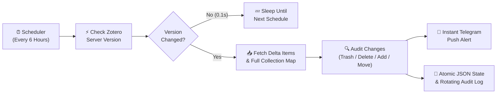

# 🛡️ Zotero Global CCTV (`zotero-cctv`)

> 🌐 **Language**: **English** | [한국어 가이드 (Korean)](./README.ko.md)

[](https://github.com/mingil/zotero-cctv/actions/workflows/docker-publish.yml)
[](https://hub.docker.com/r/kimmingil/zotero-cctv)
[](./LICENSE)

> **A lightweight, 24/7 autonomous Docker audit & security bot for Zotero libraries: Version-synced incremental delta tracking, instant detection of accidental paper deletions or trash movements, collection transfer auditing, and real-time Telegram push notifications.**

---

## ✨ Why Zotero Global CCTV?

When managing thousands of academic papers in a personal or shared laboratory Zotero library—especially alongside AI automation tools, multiple co-authors, or multi-device sync—**accidental deletions, unintended moves to the Trash, or misfiled references can silently corrupt months of literature curation.**

**Zotero Global CCTV (`zotero-cctv`)** acts as a 24/7 security camera for your entire Zotero library:

### 🌟 6 Key Features

1. **⚡ 0.1-Second Delta Version Synchronization**
   - Queries `zot.last_modified_version()` first on every scheduled scan.
   - If no changes occurred since the last recorded `library_version`, the scan finishes in **0.1 seconds** with near-zero API overhead.
   - When changes exist, it fetches **only the delta** (`since=last_version`), comfortably handling libraries with **10,000+ papers** using less than 30MB of RAM.
2. **🚨 Dual Trash & Permanent Deletion Guard**
   - Detects both **permanent deletions** (`zot.deleted(since=...)`) and **items moved to the Zotero Trash** (`deleted: 1` flag in modified items).
   - Immediately sends a **Telegram push alert** specifying the exact paper title and the folder(s) (`collections`) it belonged to before disappearing—so you can restore it in seconds.
3. **🗂️ Unlimited Collection Mapping & Self-Healing Cache**
   - Paginates through **all collections (`zot.everything(zot.collections())`)**—supporting libraries with hundreds of sub-collections beyond Zotero's 100-item single-page limit.
   - Maintains a persistent `collections_map` history so even if a folder and its papers are deleted simultaneously, the alert still reports the original human-readable folder name.
   - Includes a **Self-Healing Engine (`--heal`)** that automatically resolves any legacy unknown folder keys (`알수없는폴더(...)`) and filters out non-bibliographic noise (`note`, `attachment`, `annotation`).
4. **🔄 Complete Audit Log (`zotero_audit_global.log`)**
   - Records every **New Addition (`✨`)**, **Folder Transfer (`🔄 IN / OUT`)**, and **Deletion/Trash Event (`🚨`)** with timestamps in a size-rotated log file (`5MB × 3 backups`).
5. **✈️ Smart Telegram Rate-Limit Protection**
   - Sends instant individual notifications for 1–3 deleted items, and automatically switches to a **consolidated batch summary** when 4+ papers are deleted at once (with automatic 4,000-character chunking and `HTTP 429` retry protection).
   - Optional flags (`ALERT_ON_ADD`, `ALERT_ON_MOVE`) let you receive Telegram notifications for newly added or moved papers as well.
6. **💾 Crash-Safe Atomic State Persistence & Network Resilience**
   - Uses atomic file replacement (`tempfile` + `os.fsync` + `os.replace`) so `zotero_state_global.json` is never corrupted even during sudden NAS power loss or container restarts.
   - Built-in exponential backoff retry (`retry_api_call`) automatically recovers from temporary DNS or Zotero API network glitches.

---

## 🏗️ Architecture & Workflow



---

## 🚀 Quick Start (1 Minute)

Multi-architecture Docker images (`linux/amd64` and `linux/arm64`) are officially published on **Docker Hub** (`kimmingil/zotero-cctv:latest`) and **GitHub Container Registry** (`ghcr.io/mingil/zotero-cctv:latest`). Works out of the box on **Synology NAS (Container Manager)**, Linux servers, Raspberry Pi, and Windows/Mac Docker Desktop.

### Option A. Run Instantly via Docker Hub Image (Recommended)

No need to clone the source code or build anything locally. Only 2 files (`compose.yaml` and `.env`) are needed:

1. Create a project directory:
   ```bash
   mkdir -p zotero-cctv && cd zotero-cctv
   ```
2. Create `compose.yaml`:
   ```yaml
   services:
     cctv-bot:
       image: kimmingil/zotero-cctv:latest
       container_name: zotero_cctv
       restart: unless-stopped
       init: true
       env_file:
         - .env
       environment:
         - TZ=Asia/Seoul
         - PYTHONUNBUFFERED=1
       volumes:
         - .:/app
       deploy:
         resources:
           limits:
             memory: 256M
   ```
3. Create `.env` (or download `.env.example`):
   ```bash
   curl -fsSL https://raw.githubusercontent.com/mingil/zotero-cctv/main/.env.example -o .env
   ```
4. Fill in your Zotero & Telegram keys in `.env` and start the container:
   ```bash
   docker compose up -d
   ```

### Option B. Clone & Build from Source

```bash
git clone https://github.com/mingil/zotero-cctv.git
cd zotero-cctv
cp .env.example .env
# Edit .env with your API keys
docker compose up -d --build
```

---

## 🔑 Environment Variables (`.env`)

| Variable | Required | Default | Description & How to Obtain |
| :--- | :---: | :---: | :--- |
| `ZOTERO_USER_ID` | **Yes** | — | Your numeric User ID (or Group ID) from [Zotero Settings > Keys](https://www.zotero.org/settings/keys) |
| `ZOTERO_API_KEY` | **Yes** | — | Zotero API key with library read access |
| `ZOTERO_LIBRARY_TYPE` | No | `user` | `user` (personal library) or `group` (shared lab group library) |
| `TELEGRAM_BOT_TOKEN` | Recommended | — | Bot token from [@BotFather](https://t.me/BotFather) on Telegram |
| `TELEGRAM_CHAT_ID` | Recommended | — | Target Telegram user/group/channel numeric Chat ID |
| `SCAN_INTERVAL_HOURS` | No | `6` | Interval between automatic audit scans (in hours, e.g. `1`, `6`, `12`) |
| `ALERT_ON_DELETE` | No | `true` | Send Telegram push alert when a paper is deleted or moved to Trash |
| `ALERT_ON_ADD` | No | `false` | Send Telegram push alert when new papers are added |
| `ALERT_ON_MOVE` | No | `false` | Send Telegram push alert when papers are moved between collections |

---

## 🛠️ CLI Diagnostic & Manual Control Commands

You can inspect the current monitoring status, trigger an immediate scan, or run a dry-run test inside the running container at any time:

```bash
# 1. [Status Check] View current library version, total tracked papers, and collection count
docker exec -it zotero_cctv python cctv_bot.py --status

# 2. [Immediate Scan] Trigger a one-time audit scan right now
docker exec -it zotero_cctv python cctv_bot.py --once

# 3. [Dry-Run Test] Test Zotero connectivity & preview changes without saving state or sending alerts
docker exec -it zotero_cctv python cctv_bot.py --dry-run

# 4. [Self-Healing Cleanup] Resolve unknown collection keys and purge non-paper notes from state cache
docker exec -it zotero_cctv python cctv_bot.py --heal
```

---

## 📂 Project Structure

```text
zotero-cctv/
├── .github/workflows/
│   └── docker-publish.yml      # Automated Pytest + Multi-arch Docker Hub & GHCR CI/CD
├── tests/
│   └── test_cctv_bot.py        # Unit test suite (pytest)
├── cctv_bot.py                 # Core Zotero CCTV version-sync audit & Telegram alert engine
├── compose.yaml                # Docker Compose configuration (Synology NAS ready)
├── Dockerfile                  # Python 3.11 slim image with built-in HEALTHCHECK
├── requirements.txt            # Python dependencies
├── .env.example                # Environment variable template
├── README.md                   # English documentation
├── README.ko.md                # Korean documentation (한국어 가이드)
└── LICENSE                     # MIT License
```

---

## 📜 License

This project is licensed under the [MIT License](./LICENSE).
